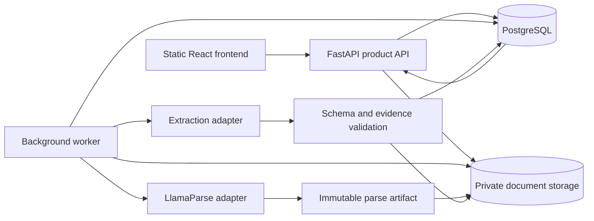

# TaffyBop parse and extract product design

Updated: 2026-11-11  
Status: PX1-01 through PX1-04 local implementation verified; live PX1 qualification remains gated

## User journey

Upload a document or reopen a saved one, choose a parsing mode, inspect the
parsed pages, define the fields to extract, run extraction, review values beside
their source, and export. A saved configuration can be applied to another
document without recreating the schema.

The visual reference is the [LlamaExtract Web UI](https://developers.llamaindex.ai/llamaparse/extract/web_ui/):
document on the left, Build and Results on the right, field/JSON editing, a run
action and saved configurations. Field names, types and descriptions follow the
documented [schema-building pattern](https://developers.llamaindex.ai/llamaparse/extract/guides/configuring-extract/).
The reference was reviewed through public documentation, not a signed-in pixel
comparison. TaffyBop keeps its own branding and backend; this does not select
LlamaExtract as the extraction service.

## Fixed workspace layout

```text
Documents   Extract   Templates                  Usage   Account
----------------------------------------------------------------
Document name    Parse mode    Template/version    Save    Run
----------------------------------------------------------------
Source preview and page selector | Build | Results | JSON
                                |
Selected page                   | Build: name, type, description,
                                | required, repeating row columns
                                |
                                | Results: typed values, statuses,
                                | evidence, review and corrections
----------------------------------------------------------------
Queued / parsing / extracting / review / complete     Downloads
```

- Keep the same layout across document types. Results are driven by the selected schema in a stable order, rather than an LLM-generated HTML layout.
- Builder and JSON are two editors for one validated schema revision. Invalid JSON cannot silently replace a valid saved template.
- Show each value's status, evidence page/snippet, and validation issues. Never display invented confidence percentages.
- Display original, reviewed and raw outputs with explicit revision labels. Human edits create a new review revision; exports identify which revision was selected.
- Use a controlled page preview for source navigation. Highlight coordinates only when backed by real source geometry. A verified page/snippet is valid evidence without a bounding box.
- Show estimates and actual usage separately. Provider/model details belong in run details, not in the ordinary field-entry flow.
- On mobile, source and results become switchable panels; preserve field order and run identity.
- Disable unavailable capabilities. No illustrative field values, generated success messages or demo documents appear as live output.

The initial navigation has Documents, Extract and Templates. An API example tab
can follow when our own API is stable. A general drag-and-drop workflow canvas
is outside this release.

## Small deployment architecture



Use the existing React/TypeScript code and Vite static build. Keep FastAPI as the
API. Run the same small backend codebase as separate API and worker processes;
do not split it into many services. The existing repository also has Next/Vinext
routes, so changes must keep those routes consistent until an explicit retirement.

Use PostgreSQL for documents, jobs, templates, review history, identities and
usage. A database-backed queue avoids a separate Redis/Celery dependency at this
stage. Earlier SQLite discussion was a single-process prototype option; this
plan selects PostgreSQL to support shared worker coordination from the start.
The PX1-02 [private persistence layer](PERSISTENCE.md) now stores owner-scoped
documents, job intent and immutable result captures. It is not wired into the
active v1 router. The [PX1-03 worker core](WORKER.md) now coordinates one
durable full-job slot, fenced polling, terminal capture and a packaged simulated
runner with immutable finite allowances. Live execution remains disabled until
account/charge-bound verification. [PX1-04 local routes/library](ROUTES.md) now
connect saved documents/jobs/results and original artifacts to an explicit
loopback development principal. Successful live parsing is still unqualified.

Use a storage interface with a local directory implementation for development
and private object storage such as R2 for hosting. Store file bytes outside the
database. Authenticate downloads or issue short-lived signed URLs after ownership
checks. Upload size/type/page limits still apply to direct-to-storage uploads.
Use expiring provider uploads and our own retained copies, not a provider file
library as the customer's long-term document store.

## Records and ownership

| Record | Required relationships and fields |
| --- | --- |
| User or account | Server-derived owner identity, plan assignment and usage window |
| Document | Owner, safe display name, content hash, MIME, size/pages, artifact IDs, retention deadline and deletion state |
| Job | Owner, document, stage, immutable settings, idempotency scope, attempt, status, provider ID, timestamps and lease/fencing generation |
| Parse result | Document/job, exact raw artifact/hash, normalized pages, warnings, provider version and usage |
| Template version | Owner, name, immutable schema/settings, version, creation time; referenced versions remain available to history |
| Extraction run | Document plus parse-result hash, template/schema snapshot, model/prompt version, output/evidence, usage and status |
| Review revision | Run, actor/time, original revision, changed values and explicit approval state |
| Usage ledger | Owner, job/attempt, reserved and actual credits/tokens/cost, price version, and reconciliation state |

All access checks use the authenticated owner, never a client-supplied owner ID.
Tenant-private cache keys include owner scope, source hash, parse settings/provider
version and schema/prompt/model versions as applicable. Avoid cross-user document
deduplication that can reveal another user's content. Reuse a valid saved parse
when only an extraction schema changes.

Authentication is an adapter boundary. Use a maintained OIDC/session integration
instead of a new password system. A single local test principal is acceptable
only with an explicit loopback development mode; hosted startup rejects that mode.
Session/CORS/CSRF rules must match the deployed origins. API keys added in PX5 are
hashed, scoped and revocable, and share the same ownership and budget controls.

## Proposed product API

PX1 schemas and HTTP semantics are frozen in [CONTRACTS.md](CONTRACTS.md), with
executable models and a JSON Schema snapshot. The local document/job/result/read
routes are implemented; ordinary product parse admission returns 503 until live
qualification. Later-phase extraction/template/usage resources remain proposed.
`/v2` keeps original raw bytes intact; the compatibility v1 GET is unchanged.

| Resource | Purpose |
| --- | --- |
| `POST /v2/documents` | Validate and persist upload; return document ID |
| `GET /v2/documents` and `GET /v2/documents/{id}` | Paginated owned library and metadata |
| `POST /v2/documents/{id}/parse` | Idempotently enqueue parsing; return 202 and job ID |
| `GET /v2/jobs/{id}` | Durable status, stage, warnings and result references |
| `POST /v2/jobs/{id}/cancel` | Request cancellation; report whether it was actually confirmed |
| `GET /v2/parse-results/{id}` | Stable normalized output and links to byte-preserved raw output |
| `POST /v2/templates` and version/list resources | Save and load versioned extraction schemas |
| `POST /v2/extractions` | Enqueue extraction for a saved parse and schema snapshot |
| `GET /v2/extractions/{id}` and review/export resources | Typed result, evidence, explicit review revisions and downloads |
| `GET /v2/usage` | Current owned reservations, observed usage and limits |
| `DELETE /v2/documents/{id}` | Immediately revoke access, then remove artifacts and schedule backup expiry |

Preserve existing `/v1/parse` and `/v1/llamaparse/*` contracts in their local
compatibility profile. Do not silently wrap the old raw JSON GET in a new
envelope. In a hosted product profile, either route legacy submissions through
the same authenticated admission service or disable them. Leaving an anonymous
legacy route public would bypass the new queue, ownership and spending limits.
The same shared-account rule applies locally: compatibility mode must either
use the durable admission controls or be mutually exclusive with the product
worker. Never run an independent legacy submitter beside the new queue against
the same provider account and assume the configured capacity is still enforced.

## Durable provider job lifecycle

1. Validate upload/settings, atomically reserve budget and persist job intent before contacting a provider.
2. Workers claim queued jobs through database coordination. Allocate a slot per provider account, not per user, API key or process.
3. Start conservatively below the configured account limit. Keep capacity reserved from submission through confirmed terminal provider state.
4. Persist the provider ID immediately. Poll known jobs with bounded backoff and jitter; browser polling reads our durable state rather than issuing uncontrolled upstream requests.
5. Persist the terminal result and any available usage before exposing completion. Provider usage can arrive later: expose result completion with usage reconciliation pending, retain the estimated budget reservation, and replace it with observed charges when available. Do not invent zero usage or withhold a completed document indefinitely because its bill is delayed.
6. A submission timeout after sending can mean the provider accepted it. Use `submission_unknown`; retain its capacity/budget reservation until reconciled. Never automatically recreate an uncertain billable job.
7. A worker lease expiring does not prove its upstream job stopped. Recover using persisted provider IDs and fencing; never release provider capacity solely because a local lease expired.
8. Cancellation is requested until confirmed. Closing the browser or pausing status checks is not provider cancellation.
9. Retry eligible transient errors with finite attempts/time/spend. Pause admission for credit exhaustion; enforce both request-rate limits and active-job limits.
10. Use per-user queue limits and fair selection. An overloaded provider creates a visible queue; additional app users do not create additional provider capacity.

Job states include `queued`, `submitting`, `submission_unknown`, `running`,
`succeeded`, `failed`, `cancel_requested` and `cancelled`. Extraction can finish
with `needs_review`. An extraction failure must not overwrite a successful parse.

## Extraction contract

Send parsed pages/tables plus field descriptions and the schema to one selected
LLM. Extract all compatible fields together when they fit the budget. Bound
schema depth, field count, array lengths, input/output tokens and job duration.
Chunk long documents with page identity preserved and deterministic merging;
surface conflicting candidates instead of choosing silently.

Start with Qwen3.7-Flash as a candidate. Compare against Ministral 3 3B or GPT-6
Luna on the same reviewed cases where access is available. Select the cheapest
model meeting the quality gate; no winner has been established. Region-specific
schema support and exact model IDs must be verified when the adapter is built.

An extracted field contains its typed value or null, a status such as found,
missing, ambiguous or invalid, source evidence and validation issues. Required
does not mean the model must invent a value. Dates/numbers retain raw source
text alongside normalized values. Repeating rows retain row order and row-level
evidence; arithmetic checks supplement, but do not prove, row correctness.

Document contents are untrusted input, not instructions to call tools, reveal
secrets or change the schema. The extraction call has no business-action tools.
Validate the response independently of the provider's JSON mode, and verify
evidence references against the stored parse. Wrong source text can still yield
valid JSON, so parsing and semantic extraction have separate benchmarks.

## Retention and plan limits

Store workflow/template definitions in PostgreSQL and document bytes/results in
object storage. Treat template count, processed pages, storage GB, retention
days, concurrent jobs and API rate limits as separate server-enforced dimensions.
The conversation's tier values are a proposal, not final commercial plans.

At expiry or deletion, revoke reads and signed-link renewal immediately, remove
primary objects, and track backup expiry. Restoring a database must reapply
deletion records and retention deadlines so deleted documents do not reappear.
Keep billing/audit metadata separate from retained document contents. Template
definitions can remain while documents expire, but history must show that source
files are unavailable. Re-running a deleted/expired parse requires a new upload.

## Performance design

Serve static assets from a CDN. Lazy-load extraction, knowledge preparation and
heavy previews. Paginate document history and fetch only the selected page's
large presentation data; do not render an entire large raw JSON response by
default. Keep API/DB in the same region and use bounded pooling/indexed owner
queries. Avoid loading legacy local OCR models in the provider-only service image.

Track initial page rendering, interaction delay, API latency, upload duration,
queue wait, provider time and result rendering separately. Validate realistic
document sizes and concurrent users, starting at 1, 10 and 25 sessions and
extending when the launch target requires it. Hosting cost estimates and a local
browser smoke test do not establish production capacity.
