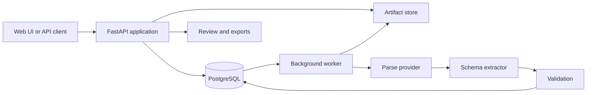

# TaffyBop parse and extract design

Status: Draft contracts for PP00-01; not an implemented v2 API

## Product boundary

Parsing answers what exists in a document and where it is located. Extraction
answers which source-backed values satisfy a requested schema. Validation checks
structure, source association and declared business constraints. Human review
records a decision or correction against a specific result revision.

Changing an extraction schema reuses an eligible parse result. Changing parser
version or options produces a new parse. An engine may need original page images
or adjacent-page context as well as parsed text; the document store preserves
those inputs.

## Current implementation to reuse

| Existing boundary | Reuse | Product work still required |
| --- | --- | --- |
| [Synchronous parser API](../../app/api.py) | Existing multipart `/v1/parse`, serializers and error behavior | Durable v2 document/parse/extraction resources |
| [Document models](../../app/models.py) | Pages, items, reading order, source geometry and evidence | Small platform envelopes; optional provider-specific detail remains separate |
| [Format adapters](../../app/services/adapter_contracts.py) | PDF/image and gated Office loading | Source connectors are a separate concern |
| [Studio](../../frontend/app/backend-workspace.tsx) and [API client](../../frontend/lib/document-api.ts) | Source inspection and original response handling | Persistent history, schemas and review revisions |
| [Visual provider hooks](../../app/services/visual_models.py) | Bounded routing concepts | Real provider wiring; current configured adapters are empty |
| [Review contracts](../../app/services/review_routing.py) | Grounded review references and decision concepts | Persistent review records and correction endpoints |

## Deployment shape for local development



Use one codebase, one application API and one worker process initially. The worker
starts with one processing slot until measured memory permits more. PostgreSQL
holds records and a leased job queue; a filesystem implementation serves the
artifact interface locally. Object storage can implement that interface later.
Scale workers when measured queue delay and memory justify it.

Modules: intake, storage, jobs, provider adapters, parsing, extraction, validation,
review, exports and usage. Keep the existing parser behind a `TaffyBopProvider`
boundary. Provider adapters declare supported tasks, inputs, limits and output
versions. New providers need not reproduce every legacy parser diagnostic.

## Records and invariants

| Record | Required meaning |
| --- | --- |
| Workspace | Owns documents, artifacts, schemas, runs, review decisions and usage. Local development may use one explicit workspace; this is not authentication for a public service. |
| Document | Immutable source bytes, SHA-256, detected MIME, original filename and source identity. Source identifies upload/API now, URL later, and future connector/external-item versions. |
| Artifact | Immutable bytes, hash, content type, owner, origin and retention state. Distinguish original source, parser JSON, provider replies, rendered page, decoded image and crop. |
| Parse run | Document/options snapshot, provider/configuration version, attempts, execution state, result reference, warnings and page coverage. |
| Schema version | Immutable fields, types, descriptions, repeating records, business-required flags and validation constraints from a documented supported subset. Unsupported schema constructs are rejected. |
| Extraction run | Parse/schema/engine versions, source-backed values, evidence, per-value state, validation outcome and observed usage. |
| Review revision | Base result/revision, actor, decision, edits and time. Approval applies to that exact revision. Original engine output remains immutable. |
| Usage entry | Workspace/run/attempt identity, reserved budget, measured consumption, attributable cost and reconciliation state. Customer credits and provider cost are different quantities. |

Evidence references a specific parse/artifact version, physical page and source
item or region. Geometry includes units and coordinate space; unavailable geometry
has an explicit reason. Missing fields are null with a reason, never invented
zeroes or empty strings. Retain row order, legitimate duplicate rows, units and
the relationship between descriptions and quantities/prices.

The first schema subset covers strings, decimal values, dates, booleans, bounded
objects and arrays of records. Preserve observed text beside typed values. Define
ambiguous date/number behavior in the schema; do not guess a locale. A schema's
required key and a business requirement for a non-null value are separate checks.

Execution state is `queued`, `running`, `completed`, `failed` or `cancelled`.
Quality state is `unreviewed`, `checks_passed`, `needs_review` or `unsupported`.
Coverage separately reports requested, completed and failed pages/regions.
Human approval is a review decision, not inferred from `completed` or valid JSON.
`checks_passed` names the checks and coverage it represents.

## Proposed API boundary

Preserve `/v1/parse` unchanged. Proposed v2 routes expose persistent resources;
the job queue stays internal.

| Route | Behavior |
| --- | --- |
| `POST /v2/documents` | Persist a bounded file upload and return document identity. |
| `GET /v2/documents` and `GET /v2/documents/{id}/content` | List authorized documents and retrieve the original source. |
| `POST /v2/parses` | Submit document ID plus options; return `202` and parse ID. |
| `GET /v2/parses/{id}` and `/result` | Return execution/coverage state and the immutable result when available. |
| `POST /v2/parses/{id}/cancel` | Request cancellation; preserve completed work and honest terminal state. |
| `POST /v2/extraction-schemas` and `/{id}/versions` | Create a schema and publish immutable versions; GET routes retrieve them. |
| `POST /v2/extractions` | Submit parse ID and schema-version ID to the actual extraction engine. |
| `GET /v2/extractions/{id}` and `/result` | Return extraction state and result. |
| `POST /v2/extractions/{id}/cancel` | Cancel queued/running extraction within declared worker limits. |
| `POST /v2/extractions/{id}/reviews` | Append a decision/correction against a base revision. |
| `GET /v2/parses/{id}/exports` and `GET /v2/extractions/{id}/exports` | Export an explicitly selected artifact/revision and format. CSV also selects a table or array. |

Creation requests accept workspace-scoped idempotency keys. Reusing a key with
a changed payload is a conflict. Workers claim and renew leases atomically; only
the current attempt can publish a terminal result. Recovery must not overwrite a
newer result or duplicate a known paid call. A provider timeout with unknown
execution/billing status is reconciled rather than blindly resubmitted.

Cache parse results by workspace, source hash, provider/version and options.
Cache extraction by immutable parse ID, schema version, extractor version and
options. An explicit reprocess bypasses reuse. Reusing results still preserves
the selected run's provenance. Retention/deletion invalidates access to associated
artifacts and caches; hashes alone do not authorize cross-workspace reuse.

## Fixed user interface

Three screens are sufficient: Documents, Extraction setup and Studio.

```text
Documents               Extraction setup             Studio
Upload / API history -> Document content             Source | Fields
Status / reopen         Tables                      page   | Tables
Retry failed run        Custom fields + schema      view   | Content
                        Test and save                      | Assets
                                                           | Raw JSON
                                      Checks and review status / Export
```

Keep tab order fixed. Empty tabs say what the backend returned; `unsupported` or
`failed` labels require corresponding backend state. Content can later show
qualified equations/charts/diagrams without inventing data for absent blocks.
Selecting a value reveals its page/region when evidence is available.

The frontend formats backend data; it does not run an independent extractor or
repair values. Setup must send the chosen schema version to the backend. An
inert schema editor does not satisfy the feature. Distinguish parser JSON, platform
JSON and extraction JSON by origin. Raw downloads preserve the selected artifact's
bytes; structured exports identify their result and schema versions.

Corrections save a new revision. Original and corrected exports are explicit
choices. A concurrent edit produces a conflict rather than overwriting another
revision. Retry, cancellation, partial output and unsupported content are normal
visible states. No success badge implies accuracy beyond the declared checks.

## Extraction and fallback

PP0 chooses one primary extraction engine through a bounded real experiment.
PP2 integrates it. A constrained deterministic implementation may qualify for
explicit source-label/table mappings; broader semantic requests need a real
capable local or hosted model. The UI advertises only the qualified subset.

PP3 adds one alternate provider. Select eligible providers by capability,
measured quality, permitted processing location, remaining deadline and budget.
Use deterministic validation signals, not model self-confidence alone. Initially
allow at most one quality fallback attempt per job, bounded by page/region and
output limits. Retain necessary surrounding context and both original/candidate
results. Provider disagreement remains reviewable.

Reserve a finite upper budget before a hosted call and reconcile attributable
usage afterward. Unknown cost is unknown, not zero. Disable automatic routing
when a safe cost ceiling cannot be established. Promotional free credits are an
optional accounting input, not the product's sustainable cost assumption.

## Later sources and specialist capabilities

URL intake needs bounded redirects, public-network destination checks, MIME/size
validation and timeouts. Email/cloud adapters later resolve external documents
into the same immutable source contract, with connector credentials held on the
server and checkpoint/deduplication behavior tested separately.

Each specialist advertises supported input families and output semantics:
handwriting gives source-backed text/fields; formulas give editable notation;
charts give values with series, axes, units and tolerances; diagrams give labels,
nodes and edges. A textual description alone does not qualify a numeric chart or
diagram-topology task.
